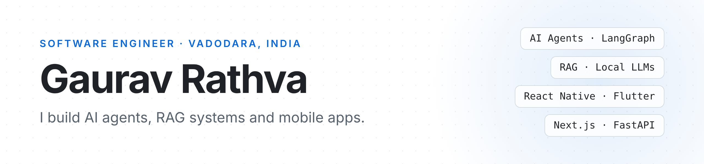
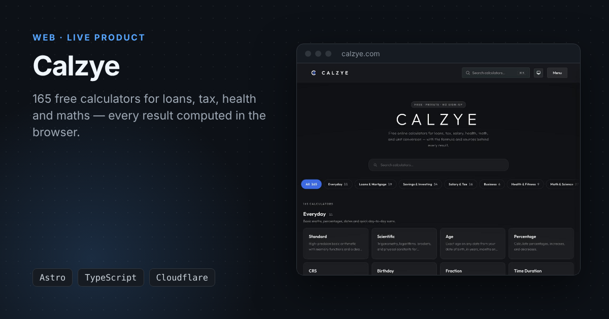
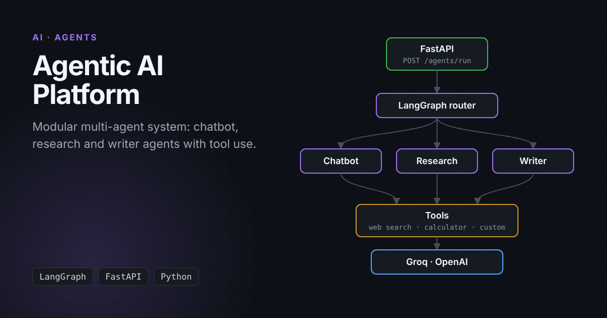
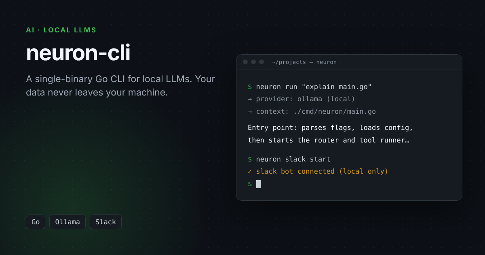
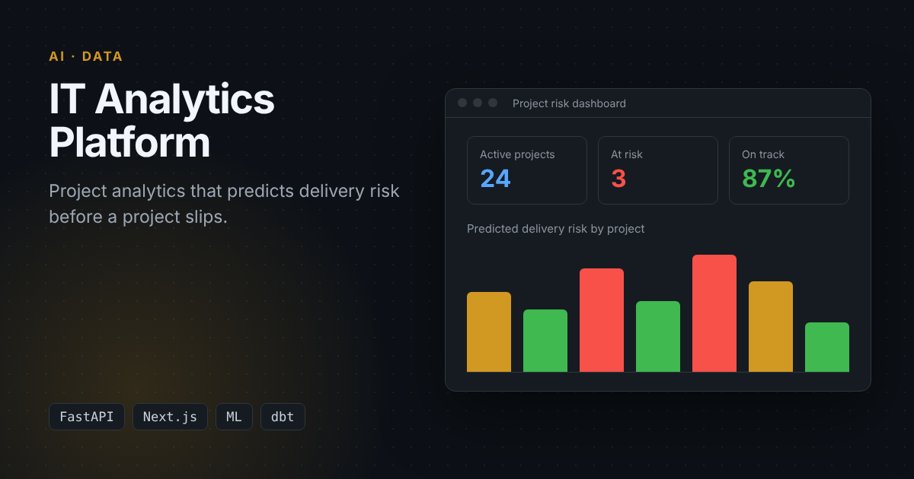
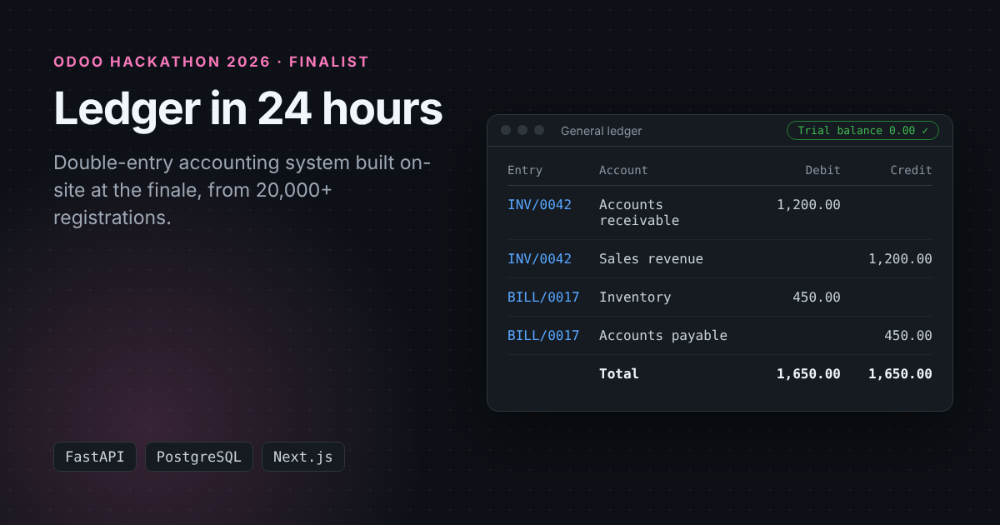

<picture>
  <source media="(prefers-color-scheme: dark)" srcset="assets/banner-dark.png">
  
</picture>

I'm a software engineer in Vadodara, India, with 4+ years shipping mobile apps in React Native and Flutter. Today I focus on AI: agents, RAG systems and local LLMs.

**Stack** · Python · TypeScript · Go · LangChain · LangGraph · FastAPI · NestJS · React Native · Flutter · Next.js · PostgreSQL · Firebase

### Selected work

<table>
  <tr>
    <td width="50%" valign="top">
      
       <b><a href="https://calzye.com">Calzye</a></b> · live
       165 free calculators for loans, tax, health and maths, all computed in the browser.
    </td>
    <td width="50%" valign="top">
      
       <b><a href="https://github.com/gaurav3000R/agentic-ai-platform">Agentic AI Platform</a></b>
       Multi-agent system with LangGraph and FastAPI: chatbot, research and writer agents with tools.
    </td>
  </tr>
  <tr>
    <td width="50%" valign="top">
      
       <b><a href="https://github.com/gaurav3000R/neuron-cli">neuron-cli</a></b>
       Single-binary Go CLI for local LLMs (Ollama), with a Slack bot. Data stays on your machine.
    </td>
    <td width="50%" valign="top">
      
       <b><a href="https://github.com/gaurav3000R/Innovatrix-project">IT Analytics Platform</a></b>
       Project analytics with ML delivery-risk predictions. FastAPI, Next.js, dbt.
    </td>
  </tr>
  <tr>
    <td width="50%" valign="top">
      
       <b><a href="https://github.com/patelsahil2k03/innovatrix-645-odoo-hackathon-2026-finale">Odoo Hackathon 2026 — Finalist</a></b>
       Picked from 20,000+ registrations. Built a double-entry ledger in 24 hours on-site.
    </td>
    <td width="50%" valign="top">
      <b>More on GitHub</b>
       
        <a href="https://github.com/gaurav3000R/RAG">RAG</a> — question answering over your documents with a local FAISS store 
        <a href="https://github.com/gaurav3000R/CodeAtlas">CodeAtlas</a> — architecture rules and code quality for AI-assisted projects 
        <a href="https://github.com/gaurav3000R/FreshCarts">FreshCarts</a> — grocery ordering app, native Android + Firebase
      
    </td>
  </tr>
</table>

### Contact

[Portfolio](https://gauravrathva.me) · [LinkedIn](https://www.linkedin.com/in/gauravrathva/)
